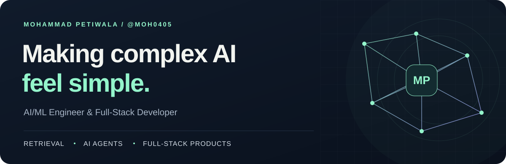
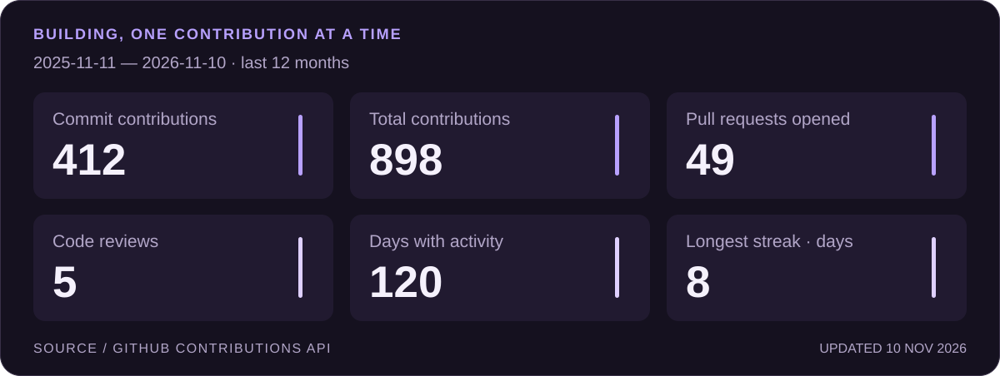
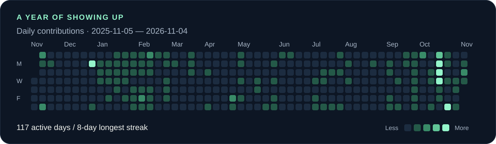

  <picture>
    <source media="(max-width: 600px)" srcset="assets/header-mobile.svg">
    
  </picture>

  <a href="https://www.linkedin.com/in/mohammad-petiwala-79b997271/">LinkedIn</a> &nbsp; / &nbsp;
  <a href="mailto:mohdpeti0405@gmail.com">Email me</a> &nbsp; / &nbsp;
  <a href="https://ai-study-mentor-two.vercel.app">Try my AI study mentor</a> &nbsp; / &nbsp;
  <a href="https://instagram.com/moh0405">Instagram</a>

 

## A little about me

I'm **Mohammad**, an AI/ML engineer and full-stack developer building tools that make complex information easier to understand. My work connects retrieval, language models, and thoughtful interfaces, from a tutor that cites your textbooks to a copilot for clinical trial data.

I care about the whole system: **how it retrieves, how it reasons, how it's evaluated, and how it feels to use.**

- **Building:** RAG systems, tool-using agents, and AI applications with Python and TypeScript.
- **Exploring:** hybrid search, retrieval evaluation, and efficient LLM inference.
- **Beyond code:** International Rank **3** in Mental Math.

 

## The work, in numbers

Updated daily from GitHub. The reporting dates appear on each card. Contributions include more than commits; counts follow [GitHub's contribution rules](https://docs.github.com/en/account-and-profile/concepts/contributions-visible-on-your-profile). Only activity visible to the workflow is included.

 
 

## Selected projects

### 01 / Lectern · AI Study Mentor

**A study companion that answers from your sources and checks its citations.**

Hybrid retrieval combines semantic search and BM25 over textbooks, lectures, and repositories. A streaming interface brings together cited answers, flashcards, a Socratic tutor, and tool-using agents.

`Python` `FastAPI` `Next.js` `TypeScript` `LangGraph` `MCP` `AWS`

[Explore the code ↗](https://github.com/moh0405/Lectern) &nbsp; · &nbsp; [Try the demo ↗](https://ai-study-mentor-two.vercel.app)

---

### 02 / Paritty

**A continuous clean-to-lock copilot for clinical trials.**

Combines deterministic data checks, reconciliation, and lock-date forecasting with AI-assisted drafts. Evidence verification and human approval sit at the center of the workflow.

`Clinical data` `Gemini` `Tiger Data` `AI agents`

[Explore the code ↗](https://github.com/moh0405/paritty)

---

### 03 / MedExplain AI

**Medical reports, explained in plain language.**

Turns clinical text into structured summaries and key findings, with visible parsing warnings and a fallback when model inference is unavailable.

`Python` `FastAPI` `React` `TypeScript` `LLMs`

[Explore the code ↗](https://github.com/moh0405/MedExplain_AI)

 

## My toolkit

| Area | Technologies |
| :--- | :--- |
| **AI & retrieval** | PyTorch · scikit-learn · LangChain · LangGraph · MCP · vector search |
| **Backend & data** | Python · FastAPI · NumPy · Pandas · SQL · MongoDB |
| **Frontend** | TypeScript · React · Next.js · Tailwind CSS |
| **Cloud & delivery** | AWS · Docker · Terraform · GitHub Actions · Git |

More tools I've worked with

TensorFlow · Streamlit · Node.js · Express · Django · Angular · MySQL · DynamoDB · Kubernetes · C · C++ · Java · PHP · Figma · Blender · Unity · Raspberry Pi · Arduino

 

## Let's build something useful

Interested in RAG, AI-powered learning, or a full-stack AI project? I'd love to compare ideas and collaborate.

**[mohdpeti0405@gmail.com](mailto:mohdpeti0405@gmail.com)** &nbsp; · &nbsp; [Connect on LinkedIn ↗](https://www.linkedin.com/in/mohammad-petiwala-79b997271/)

 

Good AI should make the complicated feel clear.

